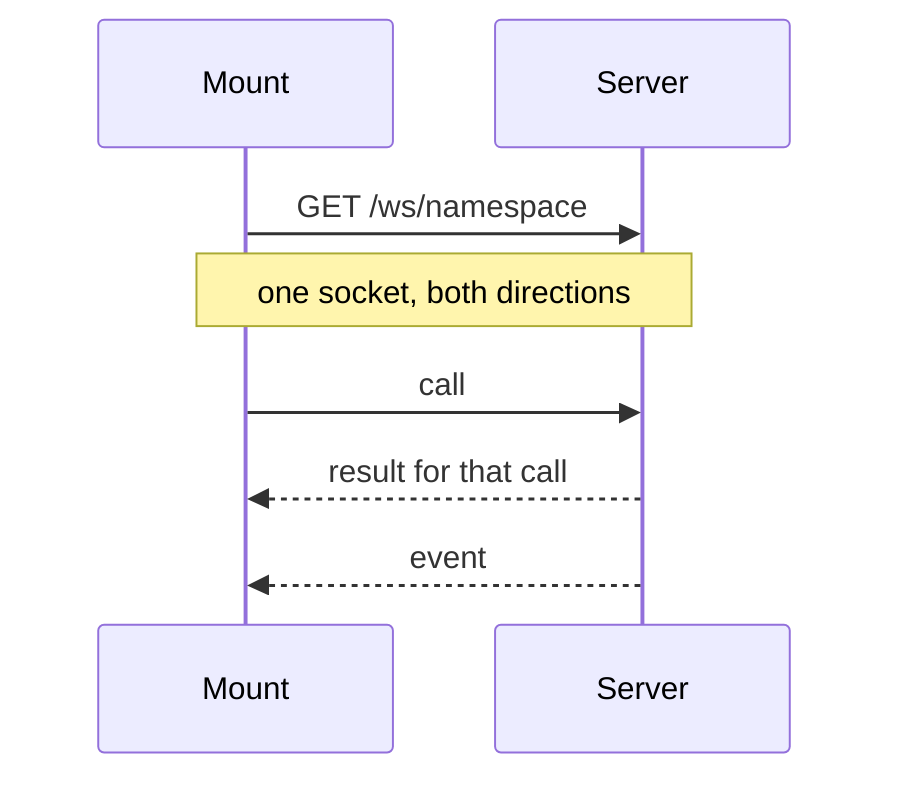
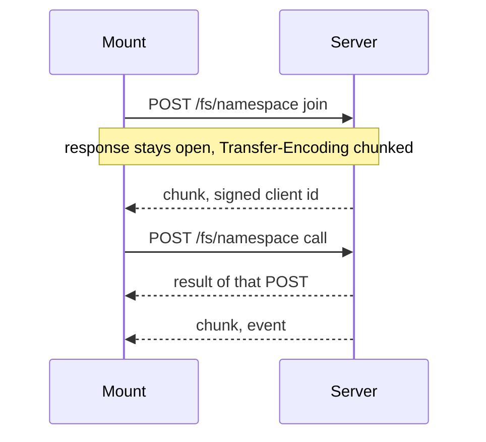
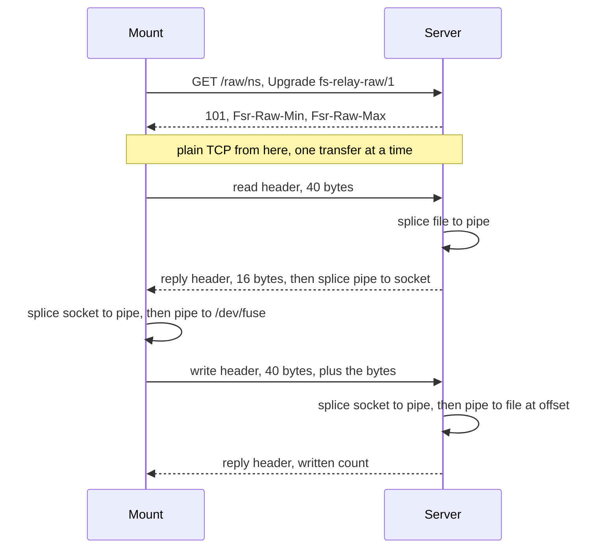
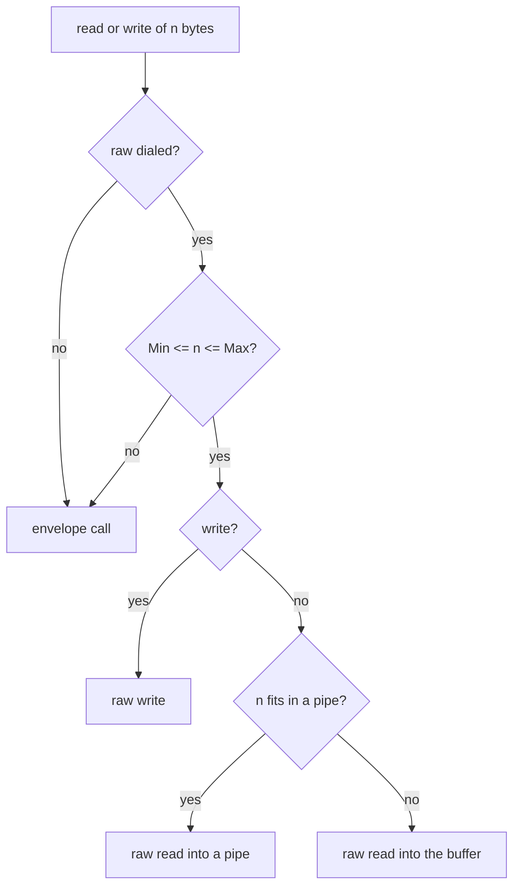

# fs-relay — design contract

`README.md` says what fs-relay is. This file is the contract: how the wire, the inodes and the locks behave. `ROADMAP.md` tracks progress. `AGENTS.md` says how the code is written.

## Problem

A directory on one host should be usable as a filesystem on another, over plain HTTP, without a kernel network-filesystem stack. The wire must carry binary file bytes, and each call must map onto a FUSE method with minimal translation, so that relaying stays cheap to write and cheap to reason about.

## Shape

Two processes:

- `fs-relay` is an HTTP server. It applies one filesystem call to the directory `data/<namespace>/`.
- `fs-relay-bind` is a FUSE3 mount (`github.com/hanwen/go-fuse/v2`, as in kvfs). It is one of the two clients below.

A third connection, described under Large transfers, carries only large reads and writes. Metadata stays on the websocket or on POST.

The path segment after `/fs/` is the namespace: `[A-Za-z0-9_-]+`, non-empty, at most 64 bytes. It selects the directory under `data/` and nothing else. There is no shard level, because there is one directory tree. Anything outside the grammar is refused before any file is touched.

## Token

Every connection except `GET /` carries one shared secret. The header is `Authorization: Bearer <token>`. The secret is at least 8 characters from `[A-Za-z0-9_-]`. Capitals are distinct. That alphabet needs no encoding in a header or a URL. The server does not write the secret into a response, a client id, or a URL.

Omit `-token` and the server prints a secret on its standard error, then uses it. Pass `-token` and that value is the secret when it meets the rule. A value that is too short, or that uses another character, stops the process before it listens. `fs-relay-bind` takes the same flag and sends the secret. It does not invent one. An empty flag on the mount stops it with `pass -token`.

A request with no secret is `401` and `{"error":{"code":401,"message":"missing token"}}`. A secret that is not the server's is `401` and `{"error":{"code":401,"message":"wrong token"}}`. `GET /` stays open: it is the welcome page and the health check.

The server names a mount with a UUIDv7 and returns `<uuid>.<signature>`. The signature is HMAC-SHA256 of the uuid, keyed by the secret, written with the URL-safe base64 alphabet and no padding. A `join` that presents an id must present that whole string. The server signs the uuid again and accepts the id only when the signature matches. Anything else is `400`. A websocket mount is named the same way. The mount keeps the id and sends it back when it joins again.

## Clients

A mount is one of two clients. Both speak the same envelope. They differ in how calls and events travel. The mount defaults to the websocket. `-post` selects the other. `-ws` is the same as the default. Passing both flags is an error.

**Websocket.** One `GET /ws/<namespace>` stays open. The socket is bidirectional. Every call and every event is one binary message on it. There is no second stream, and there is no `Transfer-Encoding` header. The websocket frame is the framing, so an event has no length prefix. The server's first message carries the client id and no call id.



**POST.** `-post` uses two directions on purpose.

- Client to server: each call is its own `POST /fs/<namespace>`. The response to that POST is the result of that call, one envelope, with a `Content-Length`. A POST has no request id. The HTTP exchange is the correlation.
- Server to client: at start the client sends `POST /fs/<namespace>` with method `join`. This is not a filesystem call. The response stays open for the life of the mount. Its headers are `Content-Type: application/x-flatbuffers` and `Transfer-Encoding: chunked`. The server does not write that transfer header itself: it sets no `Content-Length` and flushes after every event, and the HTTP server adds `Transfer-Encoding: chunked`. The body is one way, server to client. Each event is one chunk holding a little-endian uint32 length and then one envelope, not a text line. A length above the body limit closes the stream. The first event carries the signed client id. Later events are evictions or a lock release.

Calls never travel on the chunked response, and events never travel as the response of a filesystem POST.



## Large transfers

A read or write at or above a threshold moves its file bytes on a separate TCP connection, so the kernel can splice them. The mount keeps up to eight of these connections. Each one handles one transfer at a time.

The threshold is computed once, when the server starts, from the data directory:

```
Min = clamp(32 × st_blksize, 64 KiB, Max)
Max = min(1 MiB, the pipe size the kernel grants), minus 64 KiB when that still leaves at least 64 KiB
```

`st_blksize` comes from `stat` of the data directory. The server sends `Min` and `Max` on the handshake. The mount uses the raw path when the byte count is inside that window. Anything smaller, or a server that does not offer the path, stays on the FlatBuffers envelope. `-raw=false` on the mount does not dial it.



Handshake, written by the mount on a new TCP connection:

```
GET /raw/<namespace> HTTP/1.1
Host: <host>
Connection: Upgrade
Upgrade: fs-relay-raw/1
```

The server checks the namespace, hijacks, and refuses the connection if any body bytes were already buffered. It answers:

```
HTTP/1.1 101 Switching Protocols
Connection: Upgrade
Upgrade: fs-relay-raw/1
Fsr-Raw-Min: <min>
Fsr-Raw-Max: <max>
```

After that the socket is not HTTP. A missing `Upgrade` header is HTTP 400.

Request header, 40 bytes, little-endian:

| Offset | Type | Field |
|---|---|---|
| 0 | 4 bytes | magic `FSRQ` |
| 4 | u16 | op: 1 read, 2 write |
| 6 | u16 | reserved, 0 |
| 8 | u64 | inode, for a read without a handle |
| 16 | u64 | fh, always for a write, and for a read when set |
| 24 | i64 | offset |
| 32 | u32 | length, at most Max |
| 36 | u32 | reserved, 0 |

A write request is that header plus exactly `length` file bytes.

Reply header, 16 bytes, little-endian:

| Offset | Type | Field |
|---|---|---|
| 0 | 4 bytes | magic `FSRP` |
| 4 | u32 | errno, 0 on success |
| 8 | u32 | length: bytes that follow for a read, bytes written for a write |
| 12 | u32 | reserved, 0 |

A successful read is followed by exactly `length` bytes. An errno reply has length 0 and no body. A bad magic, an unknown op, a nonzero reserved field, a length of 0, or a length above Max closes the connection. A filesystem error does not.

The server moves a read into a pipe before it writes the reply, so a short read at end of file is the length in the header. It then splices that pipe to the socket. A write is spliced from the socket into a pipe and from the pipe into the file at `offset`. A host filesystem that refuses the splice into the file is copied from the pipe instead. A successful write publishes the same eviction as `write`.

The mount splices a read reply into a pipe and hands that pipe to FUSE, which splices it on into `/dev/fuse`, when the pipe can hold the reply. Otherwise it reads the reply into the FUSE buffer. A write the mount sends is one `writev` of the header and the bytes FUSE already delivered. A transport error is retried once on the envelope. A read or write at an offset is safe to repeat.



## Envelope

FlatBuffers is the only filesystem wire. The content type is `application/x-flatbuffers`. The file identifier is `FSR1`. The schema is `internal/wire/fsrelay.fbs`. One buffer is one envelope.

- `POST /fs/<namespace>`. The body is one buffer.
- `params.namespace` must equal the URL segment.
- Success: HTTP 200 and a result.
- A filesystem failure: HTTP 200 and an error whose `code` is a Linux errno.
- HTTP 400: bad body, unknown method, namespace mismatch, params that do not match the method.
- HTTP 500: a fault that is not an errno.
- No request id on a POST. The HTTP exchange is the correlation.
- File bytes are a byte vector. One call carries at most 1 MiB, which is also the mount's maximum write. The mount may hold several kernel writes and send them together.

`GET /ws/<namespace>` is the same envelope, one binary websocket message per call. The client sets `id` (a nonzero integer) on the request and the server copies it onto every message for that call. Calls overlap. A filesystem failure carries that `id` and the error. A fault that is not an errno carries that `id` and a fault string, and the socket stays up. A body that is not a call, an `id` of 0, a repeated `id`, or a namespace that does not match the URL closes the socket.

`setlkw` is an ordinary call. It does not hold a response open. The grant and the release arrive on the mount's one pubsub, described under Locks.

`namespace` is required and must match the URL. The other fields are the kernel arguments the method needs: `inode`, `inodes`, `name`, `new_inode`, `new_name`, `fh`, `mode`, `flags`, `offset`, `size`, `data`, `target`, `valid`, `atime`, `mtime`, `uid`, `gid`, `mask`. `inodes` is the list for `reads` and `readdirs`. `valid` uses the Linux FUSE `FATTR_*` bits. Empty strings and empty byte vectors are absent. A numeric zero is present. `valid` still says which setattr fields count, so a size or owner of zero is applied. A missing required field is HTTP 400. A name of `.`, `..`, or one that contains `/` or NUL is `EINVAL`.

Under `FSR1`, field identity is declaration order. A table only grows by a field appended at the end. Reordering, inserting, deleting, or changing a type needs a new file identifier.

## Inodes and handles

- Root is inode `1` in every namespace.
- The server keeps a process-local map between paths and inodes. The host `st_ino` is not the protocol inode: the namespace directory is not inode 1, and a copy would change it.
- Any other inode is assigned on first `lookup`, `readdir`, `create`, `mkdir` or `symlink` and returned in the result. `readdir` assigns one so a directory entry never carries inode 0. It survives a rename inside the process.
- `create` and a writable `open` return an `fh`. `write`, `fsync`, `release`, `lseek` and the lock calls name that `fh`. A read-only `read` names the inode instead.
- The server opens host files without `O_APPEND`. The kernel resolves the append offset and sends it with the write.
- The map and the open files die with the process. A transport error or a restart means the client must remount.
- `..` and absolute paths never leave `data/<namespace>/`. A name containing `/` or equal to `.` or `..` is refused with `EINVAL`.

## Methods

Names are the go-fuse methods, lowercased. Arguments are the kernel's, plus `namespace` and, where a call is about a name, the parent `inode`. The signatures mirror FUSE so that a relay is a thin translation.

M1 surface, which is also what `tar` needs: `lookup`, `getattr`, `setattr`, `access`, `statfs`, `mkdir`, `create`, `open`, `read`, `reads`, `readdirs`, `write`, `flush`, `fsync`, `release`, `opendir`, `readdir`, `releasedir`, `unlink`, `rmdir`, `rename`, `symlink`, `readlink`. `reads` returns the whole body of each named inode that is a regular file of at most 64 KiB, at most 32 inodes and 1 MiB of bytes. A larger file, an empty file, or a missing inode is omitted from that result. `readdirs` lists up to 32 directories in one call. A missing inode or a name that is not a directory is omitted. `readdir` stats each child once.

`copyfilerange` copies up to `size` bytes from `fh` or, when `fh` is absent, from `inode`, at `offset`, into `fh_out` at `offset_out`. `fh_out` and `offset_out` are appended fields of `params`. A `flags` value other than zero is `EINVAL`. The server calls `copy_file_range(2)` and returns a short count as success. The destination name is evicted.

`rename` follows `rename(2)`: a file replaces a file, a directory replaces an empty directory, and the other pairings fail with `EISDIR`, `ENOTDIR` or `ENOTEMPTY`. `RENAME_NOREPLACE` is honored. `RENAME_EXCHANGE` and `RENAME_WHITEOUT` fail with `EINVAL`.

## Coherence

Attribute and entry timeouts are 1s. The negative timeout is 500ms. A read-only open keeps the kernel page cache (`FOPEN_KEEP_CACHE`). A create, and any writable open, bypasses it (`FOPEN_DIRECT_IO`).

A write is acknowledged by the mount and sent when contiguous bytes reach 1 MiB, when a write is not contiguous, or on `fsync`, `release`, a read, a setattr or a `copyfilerange` of that file. `flush` reports an earlier send error and does not itself send. `release` sends any bytes still held and closes the server handle in that one call. A `close` of one descriptor, while another descriptor of the same file remains, leaves those bytes on the mount until the last `release`, or until one of the sends above. Other mounts see the bytes once they are sent. A failed send is reported by the next write, and by `close` or `fsync`.

A read-only open does not take a server file handle. `read` names the inode, and that open's `flush` and `release` stay on the mount. `fsync` sends bytes the mount is holding and then syncs. `readdir` carries each name's attributes. The mount answers the lookup and getattr that follow from those, until an eviction drops them. Opening a directory does not take a server handle either.

After that listing, the mount calls `reads` for the regular files in it that are at most 64 KiB. One call carries at most 32 names and 1 MiB of bytes. A larger file stays a normal `read`. The mount keeps those bodies until an eviction for that name, and stops storing them once 64 MiB is held. A read the cache cannot answer uses `read`. The same listing's child directories are fetched with `readdirs`, at most 32 per call, and a later `readdir` of one of those directories is answered from that until an eviction drops it. The mount keeps at most 8192 of those listings.

A mount is one subscriber for its namespace. There is no per-file socket and no per-lock socket.

- The server writes a heartbeat on the chunked `join` response every 2s. A mount that receives nothing for 6s treats the stream as stalled and joins again. The first try of an outage runs at once. Each try after that waits 100ms. A session that stays up for 1s clears that wait. The server keeps that mount's undelivered cache evictions, lock grants, and releases for 8s, then discards them. A rejoin inside the window receives them. A signed id the server has not seen is a new mount. An id whose signature does not match the token is refused. Inodes still die with the server process.
- A websocket client does not call `join`. The same events are envelopes on the call socket, with no call id. The websocket frame is the framing, so those events have no length prefix. The server sends a ping every 2s and the mount answers with a pong. The mount also sees the same 2s heartbeat. Six seconds of silence, or a dropped socket, fails the calls in flight and dials again. The mount stays up. The retry wait is the same as for `-post`.

The server sends an eviction after a successful `create`, `mkdir`, `symlink`, `write`, `setattr`, `unlink`, or `rmdir`, after a `release` that carried file bytes, and after a rename it sends the old name and then the new name. A refused call sends nothing. The mount reads those events on a background loop, never on a FUSE handler, and calls `NotifyEntry` and `NotifyContent`. A name this mount itself just created, wrote, or changed is left in place: the saved file body is dropped and page cache is invalidated, and the directory listing is dropped, but the name stays so the next lookup is local. Another mount still drops the name. A missed eviction leaves cached file bytes stale until the kernel drops the pages. Names and attributes recover within the 1s timeout.

## Locks

Specified now, implemented for M3.

- POSIX record locks: `getlk`, `setlk`, `setlkw`. The owner is the FUSE owner plus a per-mount client id, so two mounts never share an owner number.
- The server's lock table is the authority. `setlk` is an ordinary envelope and returns `EAGAIN` on a conflict.
- `setlkw` is an ordinary call. The FUSE handler waits on the pubsub reader. It does not hold its own response.
- A release is an envelope on that pubsub whose release field is the lock id, sent to every subscriber of the namespace. On `/ws/` it is one binary message with no call id. The waiting mount wakes and acquires. If two waiters wake together, one `setlk` wins and the other waits again.
- A dropped `join` is the rejoin above. The server repeats a release that this client has not seen, so a missed event cannot leave `setlkw` blocked.
- The server is the only writer under `data/`. A process that opens those files directly is outside the lock table.

This is what SQLite's rollback journal needs (SHARED, RESERVED and EXCLUSIVE byte ranges). WAL needs shared memory between processes and is not a goal.

## Packages

- `cmd/fs-relay`: flags, HTTP decode and encode, the raw connection, calls `internal/local`.
- `cmd/fs-relay-bind`: flags, FUSE nodes and the errno mapping, calls `internal/client`.
- `internal/wire`: FlatBuffers types, the schema, the generated file, and the raw header codec. No HTTP, no FUSE, no `os`.
- `internal/local`: the directory, the inode map, handles, locks, and the pipe used by splice. Owns every `os` call and the error sentinels.
- `internal/client`: the POST, the websocket, the `join` stream, and the raw connection.

## Testing

- `internal/local` against `t.TempDir()`: every M1 operation, path escape, errno, inode stability across rename.
- `internal/wire`: a round trip of one request and both response shapes. The buffer carries the `FSR1` file identifier.
- Lock grant, conflict, release fan-out and rejoin are tested with the lock table.
- A real mount is not a unit test. It belongs in the README smoke checklist.
- Cost: one POST per FUSE call, or one websocket frame per FUSE call on a shared socket, except `reads`, which carries up to 32 small files from one listing, except `readdirs`, which carries up to 32 child directories from one listing, and except a write, which is one call per contiguous 1 MiB or per `release`. A read or write inside the raw window is one frame on a raw connection instead. Each POST mount also holds one `join` stream. `setlkw` does not hold a stream of its own.

## Benchmarks

Against the baseline filesystem, the Go kvfs, and SMB or NFS with and without FUSE. Numbers say which run produced them.

## Out of scope

Hardlinks (`ansible.tar` has none), extended attributes, ACLs, device nodes, FUSE 2, Windows, macOS, accounts, TLS, a durable inode map, WAL.

## Vocabulary

- **namespace**: the tenant directory name under `data/`.
- **inode**: the protocol's number for a path, assigned by the server, root is `1`.
- **fh**: the server's number for an open file.
- **method**: the lowercased FUSE operation named in the envelope.
- **relay**: applying one request to the local tree.
